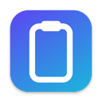
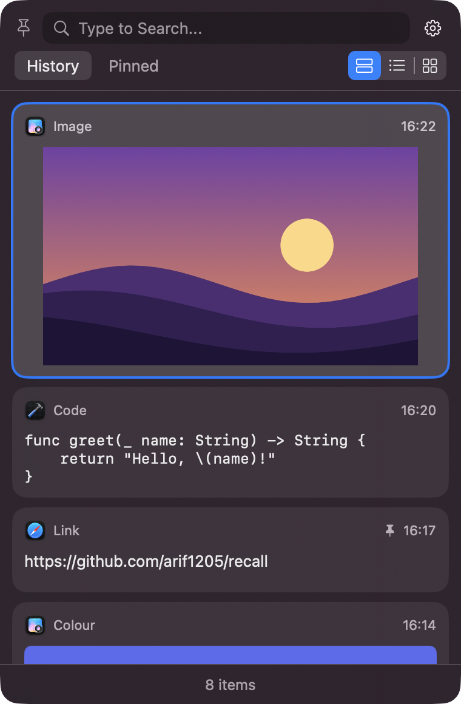
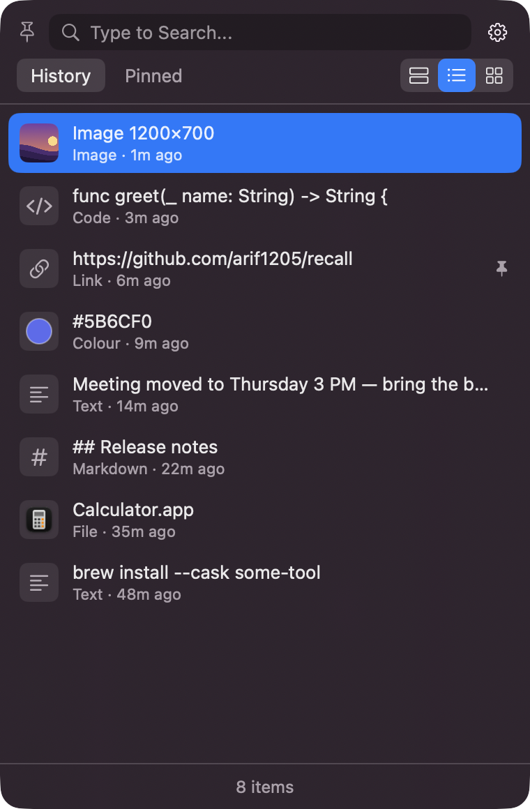
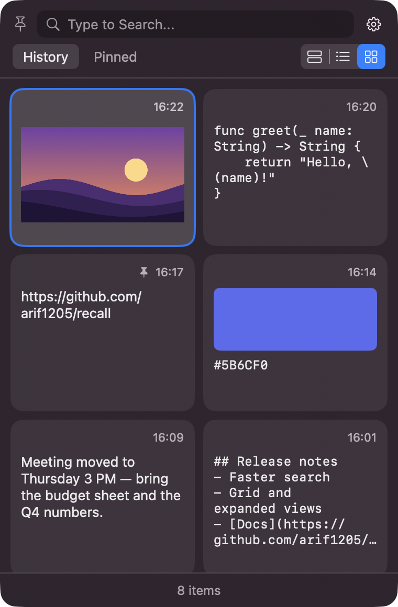

<p align="center">
  
</p>

<h1 align="center">Recall</h1>

<p align="center">A small, native macOS clipboard manager that lives in the menu bar.<br>
Everything you copy, one shortcut away. Nothing leaves your Mac.</p>

<p align="center">
  
  
  
</p>

## Features

- **Saves every copy** — text, rich text, Markdown, code, links, colour codes, images and Finder files. Each format is kept, so a clip pastes back exactly as it was copied.
- **Opens with ⌘⇧V** from any app (changeable in Settings), or from the clipboard icon in the menu bar. The icon gives a quick spin each time a copy is saved.
- **Pastes straight into the app you were using** — press Enter, or ⇧Enter to paste as plain text.
- **Three views** — Expanded (default; large image previews, several lines of text, source app), List, and a two-column Grid.
- **Search as you type**, newest clips first. Copying something again moves it to the top instead of duplicating it.
- **Pin** clips you want to keep; they never expire and survive Clear All.
- **Right-click menu** — Paste, Paste as Plain Text, Copy, Edit…, Pin, Delete.
- **Private by default** — passwords copied from password managers that mark them private (1Password, Bitwarden, Apple Passwords, KeePassXC and most others) are never saved, nothing over 25 MB is stored, and there is no network code at all.
- Keeps the last **200** clips (10–5000, set in Settings), starts at login, and can pause monitoring from the gear menu.

## Keyboard

| Key | Action |
|-----|--------|
| ⌘⇧V | Open / close the panel |
| Type | Filter clips |
| ↑ ↓ (← → in Grid) | Move selection |
| Enter / ⇧Enter | Paste / paste as plain text |
| ⌘C | Copy without pasting |
| ⌘E · ⌘P · ⌫ | Edit · pin · delete |
| ⌘, | Settings |
| Esc | Close |

## Install

Requires macOS 27 on Apple Silicon and Xcode (Swift 6.4).

```sh
git clone https://github.com/arif1205/recall.git
cd recall
./scripts/make-app.sh
```

The script builds a release version, signs it with your **Apple Development** certificate, installs it to `/Applications/Recall.app`, launches it, and also writes a drag-to-install `build/Recall.dmg`.

On first launch, allow Recall in **System Settings → Privacy & Security → Accessibility** so it can paste for you. Without it, Recall still copies the clip and you press ⌘V yourself.

> The app is signed but not notarized. On another Mac, open it the first time with right-click → Open.

## Development

```sh
swift build     # build
swift test      # 39 tests: classification, clip store, pasteboard, settings
```

- `Sources/RecallCore` — logic with no UI: clip types, history store, pasteboard read/write, settings.
- `Sources/Recall` — the menu bar app: panel, views, menus, hotkey, paste.
- `docs/` — design, decisions, discussion log, clickable mockup and the build plan.

History is stored in `~/Library/Application Support/Recall`.

Screenshots are taken with sample clips, not real clipboard data:
`Recall -RecallDataDir <folder> -RecallShowPanel YES -recall.monitoring '<false/>'`.
